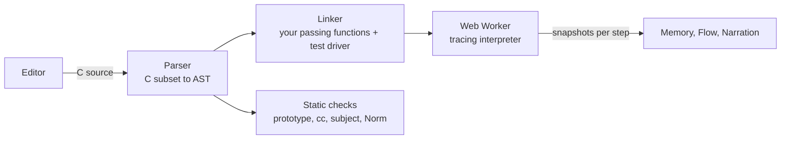

<p align="center">
  
</p>

<p align="center">
  <b>Write libft yourself, then watch your C run: every pointer, every byte, every loop.</b><br>
  A free practice space for the 42 projects libft, ft_printf and get_next_line. Hints, never answers.
</p>

<p align="center">
  <a href="https://github.com/ADELBYTES/libft-lens/actions/workflows/test.yml"></a>
  <a href="LICENSE"></a>
  <a href="https://adelbytes.github.io/libft-lens/"></a>
</p>

<p align="center">
  <a href="https://adelbytes.github.io/libft-lens/"><b>▶ Open it online</b></a> ·
  <a href="https://adelbytes.github.io/libft-lens/docs.html#tour">2-minute tour</a> ·
  <a href="https://adelbytes.github.io/libft-lens/media/libft-lens-intro.mp4">40-second video</a> ·
  <a href="https://adelbytes.github.io/libft-lens/docs.html">Docs</a>
</p>

---

## What is this?

You write each libft function yourself, line by line. libft Lens runs your code as you type and **shows you what it does to memory**: the variables, the bytes of every string, the pointers as arrows, and the exact line where something goes wrong. When you are stuck, it gives you a question or the next idea, not the answer.

It exists because many students now let an AI write their libft, pass the tests, and still cannot explain a pointer. The exam has no internet. This tool helps you actually understand your C.

<p align="center"></p>

## Start learning

### Option 1: online (easiest)

Open **https://adelbytes.github.io/libft-lens/** and pick a function. Nothing to install, no account. Your code is saved in your browser and never leaves your computer.

New here? Take the **[2-minute tour](https://adelbytes.github.io/libft-lens/docs.html#tour)** first.

### Option 2: on your own computer

You need **Python 3** (already installed on macOS and Linux; on Windows, get it from [python.org](https://www.python.org/downloads/)). Nothing else: no build, no packages.

1. **Get the code.** Either click the green **Code** button on this page, choose **Download ZIP** and unzip it, or use git:

   ```bash
   git clone https://github.com/ADELBYTES/libft-lens.git
   cd libft-lens
   ```

2. **Start it** from inside the folder:

   | macOS / Linux | Windows |
   |---|---|
   | `python3 tools/serve.py 8080` | `py tools\serve.py 8080` |

   (If you have Node.js, `npm start` does the same thing.)

3. **Open http://localhost:8080** in your browser. Leave the terminal open while you work; press `Ctrl+C` in it to stop.

## How to learn with it

1. **Pick a project and a function.** libft goes from easy (`ft_isalpha`) to hard (`ft_lstmap`). Then try ft_printf and get_next_line.
2. **Read the card.** It gives the goal in plain words, the exact prototype from the subject, and what you are allowed to call.
3. **Replace the `/* ▢ … */` steps with your own code.** Each placeholder is one step of the plan. The current step is shown right above the editor.
4. **Watch the tests.** Half a second after you stop typing, your code runs against every test. Red means something to look at, not a failure.
5. **Step through a failing test.** Press **Next** or **Play**, or click a line of your code to see memory at that moment. Follow the arrows. Look for the cell that turns red.
6. **Fix it and move on.** When the tests pass and the checks are clean, you get **Exercise complete** and a **Next** button.

A few tips that make it stick:

- **Try before you reveal.** Ask "Stuck?" for a question first. Reveal a step's explanation next, then the blanks. Use the full code only as a last resort.
- **Redo the ones you revealed.** Exercises where you showed the code get a ring on the rail. Write them again from scratch a day later.
- **Confirm for real.** Before you submit, compile with `cc -Wall -Wextra -Werror` and run `norminette`. This tool is strong evidence, not a guarantee.

## What you can practise

| Project | Exercises | What the visuals show you |
|---|---|---|
| **libft** (subject v19.3) | All 43 functions, Part 1, Part 2 and the bonus lists | Strings byte by byte, `'\0'`, pointers into arrays, `malloc` blocks, linked-list nodes |
| **ft_printf** (v12.1) | 5 helpers, then `ft_printf` | The `...` arguments and which one the next `va_arg` takes; output compared with the real `printf` |
| **get_next_line** (v14.3) | 5 helpers, then `get_next_line`, plus bonus tests | The file with a read cursor, each `read()` filling your buffer, and the `static` stash surviving between calls |

Each exercise is checked like an evaluation: tests from the subject and the man pages (empty strings, overlapping memory, `INT_MIN`, `BUFFER_SIZE` from 1 to 9999, `malloc` failing), plus the prototype, forbidden functions, what `cc -Wall -Wextra -Werror` would refuse, the subject's rules and a partial Norm.

The app stops at the exact line, with a plain explanation, when your code reads or writes past the end of an array or a `malloc` block, uses `NULL`, uses memory after `free`, frees twice, writes into a string literal, keeps a pointer to a dead local variable, uses a variable before setting it, forgets a `return`, loops forever, or leaks memory.

There is also a **Free code** mode: paste any C program with a `main` and watch it run.

## Questions students ask

**Is this allowed at 42?** The subjects ask you to reason before asking for help and never to ask for direct answers. libft Lens is built around that: it shows what *your* code does and keeps answers back until you ask several times. If you are unsure, check your campus's rules.

**If an exercise is green here, will I pass?** It is a good sign, not a promise. The interpreter covers the C that these projects use and checks part of the Norm. Always confirm with the real compiler and `norminette`.

**Where is my code saved?** In your browser's storage, on your computer only. Use the same browser to find it again. The [docs](https://adelbytes.github.io/libft-lens/docs.html#privacy) have a button to delete everything.

**Can I use my own code from my repo?** Yes: paste a function into its exercise, or a whole program into Free code.

**What C does it understand?** Integers, pointers, arrays, structs, function pointers, variadic functions (`va_list`), `static`, `#define` and `#ifndef`, `malloc`/`free`, `write`, `read` and in-memory files. Not yet: `float`, `union`, `enum`, `switch`, `goto` and macros with arguments.

**I found a bug or a wrong test.** Please [open an issue](https://github.com/ADELBYTES/libft-lens/issues) with the code that shows it.

---

## For reviewers: how it is built

- **A C interpreter written from scratch** in plain JavaScript (lexer, preprocessor, parser and tracing interpreter, about 2,000 lines). It models a 64-bit process byte by byte, which is what lets it catch memory bugs at the exact line and draw every step.
- **No dependencies and no build step.** About 7,900 lines of hand-written HTML, CSS and JavaScript, served as static files.
- **Content checked by its own tests.** 66 automated tests. For all 55 exercises they prove that the reference solution passes every test, compiles cleanly, follows the Norm and the subject's rules, and does not leak when `malloc` fails, and that every starter fails until the student writes code.
- **Responsive under load.** Student code runs in a Web Worker with step, output and allocation limits and a watchdog, so an infinite loop never freezes the page.
- **Animation without a framework.** Memory changes animate with a measure-then-animate (FLIP) approach on stable keys; pointer arrows interpolate between old and new targets.
- **Secure by default.** Strict Content-Security-Policy, no outgoing connections, everything escaped, and progress rebuilt from code on every load so it cannot be faked.



The interpreter keeps one flat byte array with a `NULL` page, red zones between blocks, freed blocks that are never reused, read-only string literals and a signed `char`, so memory bugs behave the way they would on a real machine. Each step records a snapshot (frames, blocks, pointer targets, that step's reads and writes) for the views to draw.

| File | What it does |
|---|---|
| `src/lexer.js`, `src/parser.js`, `src/types.js` | C subset to AST with statement ids; preprocessor; LP64 type model |
| `src/interp.js` | Tracing interpreter, memory model, built-in libc and files, bug detection |
| `src/program.js`, `src/worker.js` | Linking functions and test drivers; running off the main thread |
| `src/checks.js` | Prototype, forbidden-function, compiler, subject and Norm checks |
| `src/libft.js`, `src/packs.js`, `src/exercises.js`, `src/blocks.js` | Subjects, test drivers, hints, reference solutions with hidden steps |
| `src/flow.js`, `src/app.js` | Flowchart graph; the UI |
| `demo/` | The intro film as a canvas animation, drawn as a pure function of time |
| `tools/serve.py`, `tools/shots.mjs`, `tools/render-intro.mjs` | No-cache dev server; tour screenshots with headless Chrome (also a click-through smoke test); the intro film rendered frame by frame at 60 fps and encoded with ffmpeg |

### Tests

```bash
npm test
```

### Privacy and security

Your code never leaves your computer: it runs in your browser, and files and progress live in local storage only. Pages ship a strict Content-Security-Policy and send no referrer; your C is interpreted, never run as JavaScript, and every value shown on screen is escaped. The reference solutions ship with the page so the step reveals work without a server: it is a learning tool, not an exam. Found a security issue? Please open a private security advisory rather than a public issue.

### Roadmap

Next: an AI coach in a chat box beside your code, running on your own machine (Ollama, any OpenAI-compatible local server, or a small model in the browser). It will only see what the interpreter proved, never the reference solution, and will answer with questions and explanations rather than code. Later: a C Piscine pack, the ft_printf bonus flags, more of the C language, progress export, offline install and translations. Details in the [roadmap](https://adelbytes.github.io/libft-lens/docs.html#roadmap).

### Contributing

Issues and pull requests are welcome. To add or change an exercise, edit `src/exercises.js` or `src/packs.js` (the reference solution with its hidden steps) and the test drivers, then run `npm test`. It refuses any exercise whose reference fails a test, breaks the Norm or leaks.

### License

[MIT](LICENSE): use it, change it and share it, including in your own projects and courses. Keep the copyright notice.

---

Made by [ADELBYTES](https://github.com/ADELBYTES) for 42 students who want to understand their C, not just pass it.
