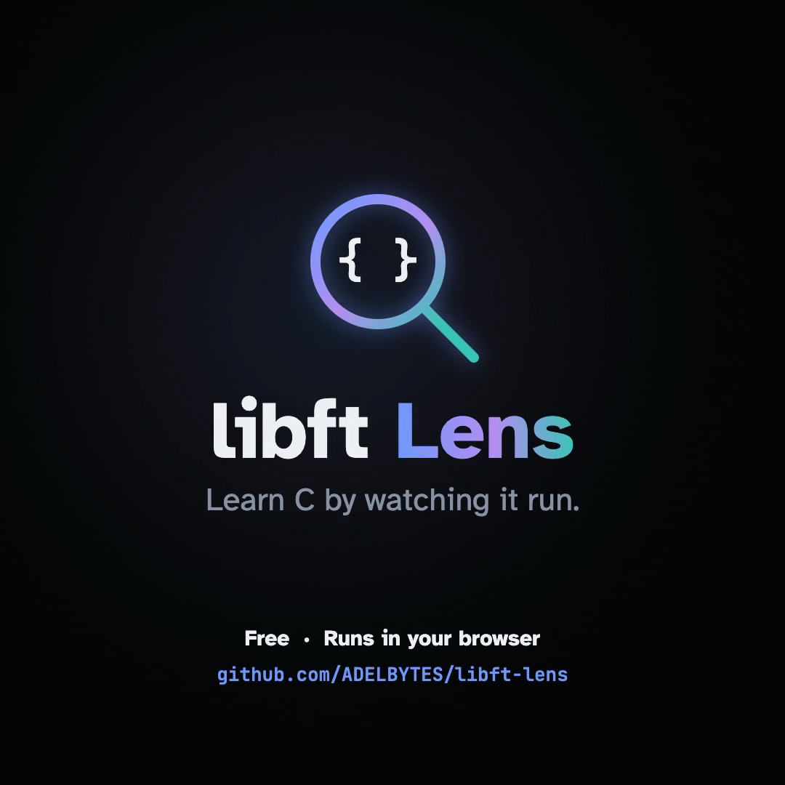
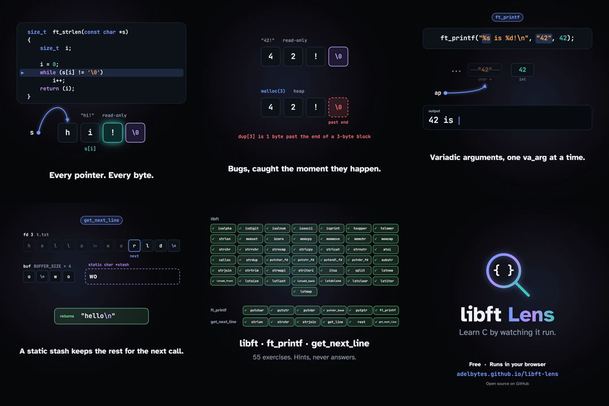
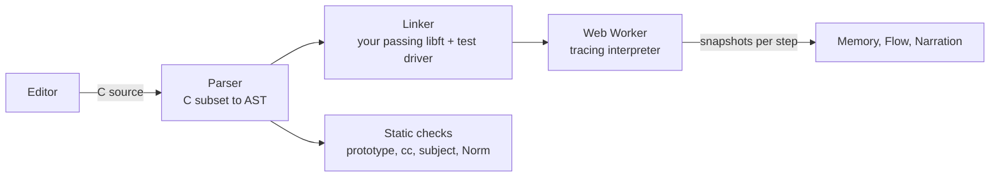

<p align="center">
  
</p>

<p align="center">
  <b>Write libft yourself, then watch your C run: every pointer, every byte, every loop.</b><br>
  A free, browser-only practice space for the 42 projects libft, ft_printf and get_next_line. Hints, never answers.
</p>

<p align="center">
  <a href="https://adelbytes.github.io/libft-lens/"><b>Try it live</b></a> ·
  <a href="https://adelbytes.github.io/libft-lens/media/libft-lens-intro.mp4">Watch the 30-second intro</a> ·
  <a href="https://adelbytes.github.io/libft-lens/docs.html">Docs</a> ·
  <a href="https://adelbytes.github.io/libft-lens/docs.html#roadmap">Roadmap</a>
</p>

---

## Why

Many students now let an AI write their libft, pass the tests, and never become fluent in C. Then the exam has no internet, and pointers, memory and edge cases are still a mystery.

libft Lens goes the other way. You write every function yourself. The app runs your code as you type and shows exactly what it does to memory, line by line, so you understand why it works, or why it doesn't. When you are stuck it gives you the next idea, not the code.

<p align="center"></p>

## What it does

- **Three projects.** All 43 libft functions (subject v19.3), ordered from easy to hard; ft_printf (v12.1) and get_next_line (v14.3, with optional bonus tests), each split into helpers and then the function the subject asks for. Every step has a goal in plain words, the prototype, the allowed functions, tests, hints and a starter whose placeholders lay out the plan.
- **The hard parts made visible.** get_next_line's `static` stash in its own box that survives between calls, open files with a read cursor so you see what each `read()` consumed, and the `...` arguments of ft_printf with the one the next `va_arg` will take highlighted.
- **Runs as you type.** Half a second after you stop typing, your code runs against the selected test in a background worker. Click any line to see memory at the last moment it ran.
- **Memory you can see.** Stack frames, arrays, string literals and `malloc` blocks drawn cell by cell, with pointers as arrows, including `char **` arrays and `t_list` nodes. Stepping forward animates what changed: frames slide, arrows glide, bytes fly from source to destination, freed blocks crumble.
- **Logic you can see.** A flowchart of the running function lights up the next line and the path just taken, and counts how often each line ran.
- **Real bugs, caught at the line.** Out-of-bounds reads and writes, `NULL` dereference, use after free, double free, writes to string literals, dangling stack pointers, uninitialised values, missing returns, infinite loops and leaks, each explained in plain words.
- **Checked like the evaluation.** ft_printf is compared with the real `printf`, return value included; get_next_line runs with several `BUFFER_SIZE` values, standard input and bad file descriptors. Tests include edge cases and simulated `malloc` failures (functions must return `NULL` and free what they allocated). The app also checks the prototype, forbidden functions, what `cc -Wall -Wextra -Werror` would refuse (unused variables, implicit declarations, signed/unsigned comparisons), the subject's rules (no globals, static helpers) and a partial Norm.
- **Help in small doses.** A question first, then the concept. Each step of the plan reveals as a purpose, then a plain-language step, then the code with blanks, and only then the code. Revealing code marks the exercise as assisted.
- **Free code mode** to paste and visualise any C in the supported subset.

## Try it

Open **[https://adelbytes.github.io/libft-lens/](https://adelbytes.github.io/libft-lens/)**: nothing to install, no account, and your code stays in your browser.

To run it locally there is no build step and no dependency: clone and serve the folder.

```bash
git clone https://github.com/ADELBYTES/libft-lens.git
cd libft-lens
npm start
```

Then open http://localhost:8080. (`npm start` runs a tiny Python static server with caching off; any static server works.)

## Engineering highlights

- **A C interpreter written from scratch** in plain JavaScript (lexer, preprocessor, parser and tracing interpreter, about 2,000 lines). It models a 64-bit process byte by byte, which is what lets it catch memory bugs at the exact line and draw every step.
- **No dependencies and no build step.** About 7,500 lines of hand-written HTML, CSS and JavaScript, served as static files.
- **Content checked by its own tests.** 66 automated tests. For all 55 exercises they prove that the reference solution passes every test, compiles cleanly, follows the Norm and the subject's rules, and does not leak when `malloc` fails, and that every starter fails until the student writes code.
- **Responsive under load.** Student code runs in a Web Worker with step, output and allocation limits and a watchdog, so an infinite loop never freezes the page.
- **Animation without a framework.** Memory changes animate with a measure-then-animate (FLIP) approach on stable keys; pointer arrows interpolate between old and new targets.
- **Secure by default.** Strict Content-Security-Policy, no outgoing connections, everything escaped, and progress rebuilt from code on every load so it cannot be faked.

## How it works



The interpreter models a 64-bit Mac or Linux process in one flat byte array: a `NULL` page, red zones between blocks, freed blocks that are never reused, read-only string literals, signed `char`. That is why memory bugs behave, and get caught, the way they would on a real machine. Each step records a snapshot (frames, blocks, pointer targets, the reads and writes of that step), which the views render.

| File | What it does |
|---|---|
| `src/lexer.js`, `src/parser.js`, `src/types.js` | C subset to AST with statement ids; LP64 type model |
| `src/interp.js` | Tracing interpreter, memory model, built-in libc, bug detection |
| `src/program.js`, `src/worker.js` | Linking libft dependencies and test drivers; running off the main thread |
| `src/checks.js` | Prototype, forbidden-function, compiler, subject and Norm checks |
| `src/libft.js`, `src/exercises.js`, `src/packs.js`, `src/blocks.js` | Subject catalogs, test drivers, hints, reference solutions with hidden steps (libft, ft_printf, get_next_line) |
| `src/flow.js`, `src/app.js` | Flowchart graph; the UI |
| `demo/` | The intro film as a canvas animation (`npm run record` saves it as a video) |

## Accuracy and limits

Supported: all integer types and `size_t`, pointers, arrays, structs, `typedef`, function pointers, `static` locals, variadic functions (`va_list` and friends), every operator, `if`/`while`/`do`/`for`, `break`/`continue`, escapes, simple `#define`s and `#if`/`#ifdef`/`#ifndef`. Files exist in memory, with `open`, `read` and `close`; tests set `BUFFER_SIZE` like `cc -D`. `#include` lines are skipped and `t_list` is provided when used.

Not yet: `float`/`double`, `union`, `enum`, `switch`, `goto`, macros with arguments. Runs stop at 300,000 steps, 20,000 allocations or 64 KB of output.

The Norm check is partial. A green exercise is strong evidence, not a guarantee: always confirm with the real `cc -Wall -Wextra -Werror`, `norminette` and your own tests.

## Privacy and security

- Your code never leaves your computer. It runs in your browser; files and progress live in local storage only, and the docs page has a button to delete them.
- Pass marks are rebuilt on every load by re-running your saved code, so editing storage cannot fake progress.
- Pages ship a strict Content-Security-Policy (scripts from this site only, no connections to other sites) and send no referrer.
- Your C is interpreted, never run as JavaScript, and every value shown on screen is escaped.
- The reference solutions ship with the page so the step reveals can work without a server. It is a learning tool, not an exam.

Found a security issue? Please open a private security advisory on GitHub rather than a public issue.

## Tests

```bash
npm test
```

The suite checks C semantics and bug detection. For each of the 55 exercises it also checks that the reference passes every test (including `malloc` failures, without leaks), matches the subject prototype, uses only allowed functions, compiles cleanly, passes the partial Norm check, and that the starter compiles with any single step filled in.

## Roadmap

Next is an AI coach: a chat box beside your code, powered by a model running on your own machine (Ollama, any OpenAI-compatible local server, or a small model such as Qwen2.5-Coder in the browser via WebGPU). It will only see what the interpreter proved (the failing test, the error, the trace), never the reference solution, and its replies are filtered to questions and explanations. After that: a C Piscine pack, the ft_printf bonus flags, more of the C language, progress export, offline install and translations. Details in the [roadmap](docs.html#roadmap).

## Contributing

Issues and pull requests are welcome. To add or change an exercise, edit `src/exercises.js` (the reference solution with its hidden steps) and `src/libft.js` (its test drivers), then run `npm test`. It refuses any exercise whose reference fails a test, breaks the Norm or leaks.

---

Made by [ADELBYTES](https://github.com/ADELBYTES) for 42 students who want to understand their C, not just pass it.
